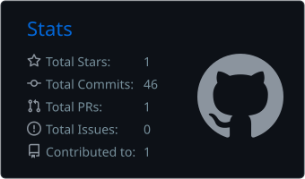
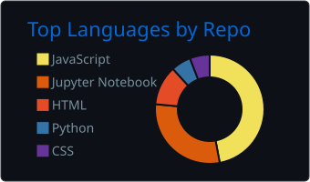

<!--
  Profile README for github.com/alwaysjeevanr
  Publish at: github.com/alwaysjeevanr/alwaysjeevanr  ->  README.md (repository must be public)

  Maintenance notes
  - Banner: capsule-render. Gradient is set with color=0:HEX,45:HEX,100:HEX
  - Badges: shields.io (logos come from simple-icons slugs)
  - Stats + languages cards: generated daily by a GitHub Action
    (.github/workflows/profile-summary-cards.yml) into profile-summary-card-output/
    and served from this repo, so they don't depend on a third-party server.
    Theme folder: github_dark (swap the folder name in the  paths to change it).
  - Streak card: live from streak-stats.demolab.com.
  - Palette used throughout: bg 0d1117 | border 30363d | text c9d1d9 | accent 58a6ff
-->

**Building modern web applications and practical software, from React interfaces to full-stack systems.**

Bengaluru, Karnataka, India

 

<a href="#about-me">About</a> &nbsp;·&nbsp;
<a href="#professional-experience">Experience</a> &nbsp;·&nbsp;
<a href="#technology-stack">Stack</a> &nbsp;·&nbsp;
<a href="#featured-projects">Projects</a> &nbsp;·&nbsp;
<a href="#github-statistics">Stats</a> &nbsp;·&nbsp;
<a href="#contact">Contact</a>

 

## About Me

I'm a **React Developer** at **Classroots Learning Innovations Private** in Bengaluru, with approximately **one year** of professional experience. I'm a Computer Science Engineering graduate who enjoys building modern web applications and developing scalable software solutions, and I like working across the stack, from the interface through to the API.

| Snapshot | |
| :--- | :--- |
| **Role** | React Developer |
| **Company** | Classroots Learning Innovations Private |
| **Experience** | Approximately 1 year |
| **Education** | Computer Science Engineering Graduate |
| **Location** | Bengaluru, Karnataka, India |

**What I'm interested in**

- React and modern frontend development
- Full-stack web development
- JavaScript and TypeScript
- Backend development and API integration
- Artificial Intelligence and Machine Learning
- Building practical software products

 

## Professional Experience

**React Developer**
Classroots Learning Innovations Private · Bengaluru, Karnataka, India
Current role · approximately 1 year

 

## Technology Stack

Technologies I work with across my repositories and development background. This is a picture of what I use, not a proficiency ranking. Frontend is my core focus; backend and AI/ML skills are applied in the projects below.

| Area | Technologies |
| :--- | :--- |
| **Frontend** |        |
| **Backend** |    |
| **Database** |   |
| **AI & ML** |      |
| **Tools** |   |

 

## Featured Projects

<table>
  <tr>
    <td width="50%" valign="top">

<b>FULL-STACK</b>

**[PlanTheTrips](https://github.com/alwaysjeevanr/PlantheTrips)**

Full-stack travel planning platform for discovering and planning vacations in India.

React · Tailwind CSS · Node.js · Express · MongoDB

[View repository →](https://github.com/alwaysjeevanr/PlantheTrips)

</td>
    <td width="50%" valign="top">

<b>FULL-STACK</b>

**Job Recruitment Platform**

Full-stack recruitment application with job listings, search, applications, resume uploads and employer features.

React · Bootstrap · Vite · Node.js · Express · MongoDB

[Frontend →](https://github.com/alwaysjeevanr/Job-Recruitment-Platform-Frontend) &nbsp;·&nbsp; [Backend →](https://github.com/alwaysjeevanr/Job-Recruitment-Platform-Backend)

</td>
  </tr>
  <tr>
    <td width="50%" valign="top">

<b>FULL-STACK</b>

**Fiverr Clone**

Freelance marketplace project with user authentication, gigs, messaging, orders and reviews.

React · Vite · Node.js · Express · MongoDB

[Frontend →](https://github.com/alwaysjeevanr/Fiverr-Clone-Frontend) &nbsp;·&nbsp; [Backend →](https://github.com/alwaysjeevanr/Fiverr-Clone-Backend)

</td>
    <td width="50%" valign="top">

<b>DEEP LEARNING</b>

**[Plant Disease Predictive Analytics](https://github.com/alwaysjeevanr/Disease-Predictive-Analytics-of-Plants-in-Agriculture)**

Deep learning project for plant disease detection using Python, TensorFlow, Keras and Flask.

Python · TensorFlow · Keras · Flask

[View repository →](https://github.com/alwaysjeevanr/Disease-Predictive-Analytics-of-Plants-in-Agriculture)

</td>
  </tr>
  <tr>
    <td width="50%" valign="top">

<b>MACHINE LEARNING</b>

**[Breast Cancer Detection](https://github.com/alwaysjeevanr/Breast-Cancer-Detection-by-jeevan)**

Machine learning classification project using Python and Scikit-learn.

Python · Scikit-learn

[View repository →](https://github.com/alwaysjeevanr/Breast-Cancer-Detection-by-jeevan)

</td>
    <td width="50%" valign="top">

<b>MACHINE LEARNING</b>

**[Spam-Ham Mail Prediction](https://github.com/alwaysjeevanr/Spam-Ham-Mail-Prediction)**

Machine learning project for email spam classification.

Python · Scikit-learn

[View repository →](https://github.com/alwaysjeevanr/Spam-Ham-Mail-Prediction)

</td>
  </tr>
  <tr>
    <td colspan="2" valign="top">

<b>AI · PRIVATE REPOSITORY</b>

**AI Personal Context**

A private AI memory and continuity project designed to maintain reusable personal context, project information and decisions across AI tools.

Repository is private

</td>
  </tr>
</table>

 

## GitHub Statistics

&nbsp;

 

## Contribution Activity

 

## Contact

&nbsp;

 

